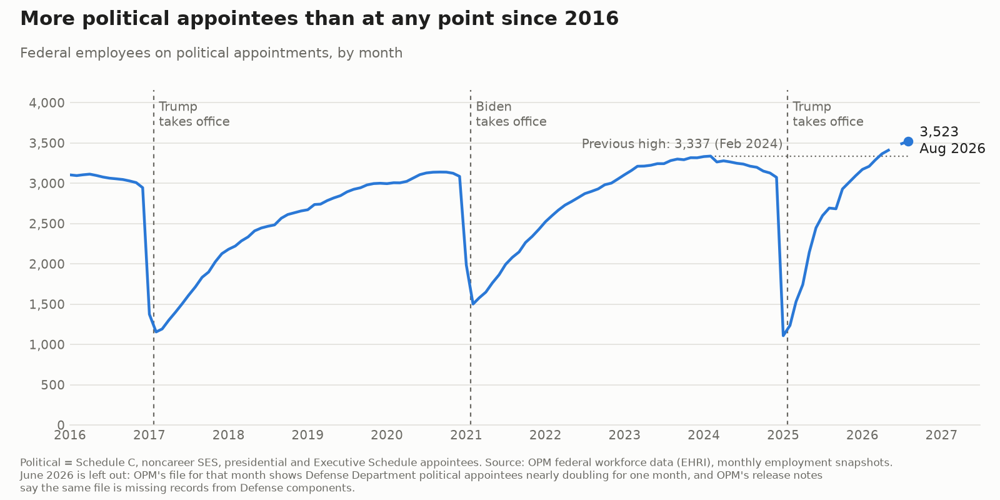
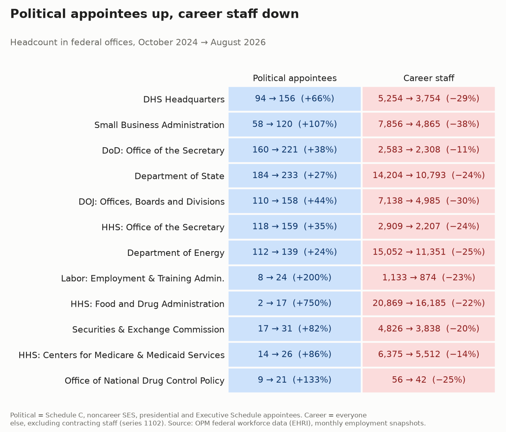

# Political appointees up, career staff down

Two charts from OPM's federal workforce data: how many political appointees the federal government has
had, month by month, and which offices added political appointees while losing career staff.

## Political appointees over time



Government-wide political appointee headcount from each monthly employment snapshot. The dotted line marks
the highest count before the latest inauguration. One month, June 2026, is left out: OPM's file for that
month shows Defense Department political appointees nearly doubling for a single month, and OPM's release
notes say the same file is missing records from Defense components. The monthly counts, including June
2026, are in `output/political_monthly.csv`.

## Offices: political appointees up, career staff down



Each row is an agency subelement, the most detailed office level in OPM's data. Cells show headcount at
the start and end months and the percent change; blue cells grew and red cells shrank. The chart shows the
offices with the largest political gain, among those that also lost career staff, after dropping small
offices and offices whose change looks like a reorganization. Every office is in
`output/political_shift_by_office.csv`.

## Run

```bash
python3 -I scripts/pull_political_monthly.py    # political headcount by month -> output/political_monthly.csv
python3 -I scripts/chart_political.py           # -> output/political_appointees.png

python3 -I scripts/download.py                  # accessions and separations for the office comparison -> data/
python3 -I scripts/pull_subelement_headcount.py # headcount by office for the two snapshot months -> data/
python3 -I scripts/shift.py                     # change by office -> output/political_shift_by_office.csv
python3 -I scripts/chart_offices.py             # -> output/political_shift_offices.png
```

Employment snapshots are read over HTTP, and only the columns needed are pulled. The two months the office
comparison uses, and the definition of a political appointee, are in `scripts/common.py`; the office chart's
row rules are constants at the top of `scripts/chart_offices.py`. `data/` is not committed.

## Definitions

- **Source**: OPM EHRI employment snapshots, accessions, and separations, via the
  `impactproject/opm-ehri-data` mirror of OPM's API (data.opm.gov).
- **Political**: appointment type 44 (Schedule C), 55 (noncareer SES), 46 or 36 (executive, mostly
  presidential appointees), or anyone on the Executive Schedule (pay plan EX), since some of those carry
  an invalid or non-political appointment code.
- **Career**: everyone else, excluding series 1102 (contracting). HHS began moving contracting staff
  between offices in September 2025, and EHRI codes the moves as new hires. Schedule Policy/Career
  (appointment type 67) counts as career here and is reported separately as `sched_pc_*`.
- **Office**: agency subelement, grouped by agency code plus subelement code, not by name.
- **Reorganization check**: `recode_gap` is the change in an office's career headcount minus (hires minus
  separations). A large gap means people were moved by a reorganization rather than hired or lost; the
  office chart leaves those offices out.

## Caveats

- "Political" is based on appointment codes. Experts and consultants (pay plans ED and EF) are almost all
  appointment type 48 and count as career here, however they were brought in.
- EHRI does not link positions over time, so it can't show a specific career job being turned into a
  political one.
- OPM revises files, and counts can change between versions.
