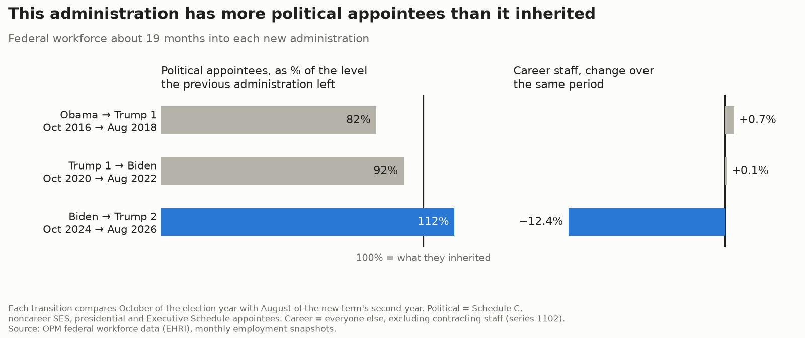

# More political appointees than it inherited

How does the number of political appointees partway into a new administration compare with the number
the previous administration left behind? And what happened to career staff over the same stretch? This
repo answers both for the last three transitions, from OPM's federal workforce data.



Each transition compares October of the election year, when the outgoing administration's appointees are
still in place, with August of the new term's second year. The left panel shows the new administration's
political appointees as a share of what it inherited. The right panel shows the change in career staff
over the same months.

## Run

```bash
run() { PERIOD_BASE=$1 PERIOD_END=$2 python3 -I scripts/download.py &&
        PERIOD_BASE=$1 PERIOD_END=$2 python3 -I scripts/pull_subelement_headcount.py &&
        PERIOD_BASE=$1 PERIOD_END=$2 python3 -I scripts/shift.py; }
run 201610 201808   # Obama -> Trump 1
run 202010 202208   # Trump 1 -> Biden
run 202410 202608   # Biden -> Trump 2 (the default in scripts/common.py)
python3 -I scripts/compare_periods.py   # one row per transition -> output/compare_periods.csv
python3 -I scripts/chart.py             # chart -> output/political_shift.png
```

- `download.py`: accessions and separations for the months in the period (used for the reorganization
  check), into `data/`.
- `pull_subelement_headcount.py`: headcount by office for the two snapshot months, split political and
  career. Snapshots are read over HTTP and only the needed columns are pulled.
- `shift.py`: change by office, one CSV per period in `output/political_shift_by_office*.csv`.
- `compare_periods.py`: government-wide totals and office counts for each transition.

The default period, and the definition of a political appointee, are in `scripts/common.py`. `data/` is
not committed; `data/files_used*.json` records which file version was used for each month.

## Definitions

- **Source**: OPM EHRI employment snapshots, accessions, and separations, via the
  `impactproject/opm-ehri-data` mirror of OPM's API (data.opm.gov).
- **Political**: appointment type 44 (Schedule C), 55 (noncareer SES), 46 or 36 (executive, mostly
  presidential appointees), or anyone on the Executive Schedule (pay plan EX), since some of those carry
  an invalid or non-political appointment code.
- **Career**: everyone else, excluding series 1102 (contracting). HHS began moving contracting staff
  between offices in September 2025, and EHRI codes the moves as new hires. Schedule Policy/Career
  (appointment type 67) counts as career here and is reported separately as `sched_pc_*`.
- **Office** (in the per-office CSVs): agency subelement, grouped by agency code plus subelement code,
  not by name.
- **Reorganization check** (per-office CSVs): `recode_gap` is the change in career headcount minus (hires
  minus separations). A large gap means people were moved by a reorganization rather than hired or lost.
  `compare_periods.py` counts only offices with a small gap.

## Caveats

- Each comparison is two points in time. Administrations keep adding appointees after the second year;
  the October starting points show the level each outgoing administration reached.
- "Political" is based on appointment codes. Experts and consultants (pay plans ED and EF) are almost all
  appointment type 48 and count as career here, however they were brought in.
- EHRI does not link positions over time, so it can't show a specific career job being turned into a
  political one.
- OPM revises files, and counts can change between versions.
